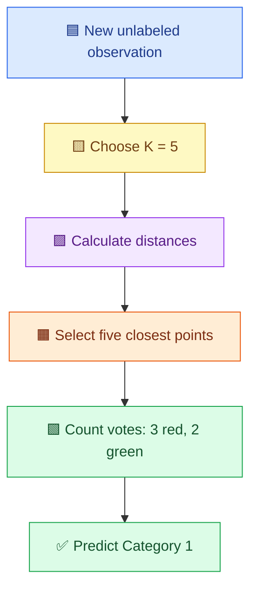

# 🌈 K-Nearest Neighbors (KNN)
## 📚 Complete Beginner-Friendly Student Notes

> **Based on:** *KNN* presentation (14 slides), by **Pardeep Kumar**.  
> **Level:** Beginners | **Topic:** Machine Learning — Classification  
> 🎯 **Learning goal:** Understand KNN from the beginning, calculate distances, choose nearby examples, and predict the class of a new observation.

---

## 🟦 1. Introduction: What Is KNN? (Slides 1–3)

**K-Nearest Neighbors (KNN)** is a **supervised machine learning algorithm** used to predict an outcome based on the **K closest previously known data points**.

- **K** = how many neighbors to consider.
- **Nearest** = closest according to a distance formula.
- **Neighbors** = existing data points with known labels.

For **classification**, the new point is assigned the label that occurs most frequently among the selected neighbors (**majority voting**).

> 🟨 **Supervised learning:** The training dataset already contains the correct answers (class labels), such as `Yes/No` or `Cat/Dog`.

### 🎨 Simple analogy: “Tell me about your friends...” (Slide 2)

Imagine joining a new college. If most of the five classmates you spend time with enjoy cricket, someone might *guess* that you enjoy cricket too. KNN uses a similar idea, except it relies on **measured similarity** rather than actual friendships.

**Remember:** The analogy explains the idea; people do not necessarily share their friends' interests!

### 🧩 Classification example (Slide 3)

Suppose a chart contains **red squares (Class A)** and **blue circles (Class B)**. A new point `?` appears.

- We find the **3 closest** labeled points (`K = 3`).
- If **2 are blue** and **1 is red**, the majority is **blue**.
- KNN predicts **Class B**.

<div style="background:#eff6ff;border-left:5px solid #2563eb;padding:12px;border-radius:8px"><strong>🔵 Key idea:</strong> KNN does not learn a single classification formula beforehand. It compares the new case with stored examples when a prediction is needed.</div>

---

## 🟩 2. What KNN Does for You (Slides 4–5)

The PPT illustrates points from **Category 1** (red) and **Category 2** (green), plus a new unlabeled point.

**Before KNN:** We can see where the point lies, but its category is unknown.  
**After KNN:** The algorithm finds the nearest existing observations and assigns the majority category.

### 🌈 Mini visual

```text
Legend: 🔴 Category 1     🟢 Category 2     ❓ New observation

   🔴      🔴                    🟢
       🔴         ❓        🟢
   🔴        🔴          🟢      🟢

KNN looks at the nearby labeled points, not simply the largest group overall.
```

> 🟩 **Important:** A class with more observations in the *entire dataset* does not automatically win. KNN considers only the selected **K nearest neighbors**.

---

## 🟧 3. KNN Algorithm: Step by Step (Slides 6–13)

The PPT describes four main steps:

| Step | 🔎 What to do | 💡 Meaning |
|:--:|---|---|
| **1** | Choose **K** | Decide how many neighbors to compare. |
| **2** | Find the **K nearest neighbors** | Calculate distances to all training observations and select the K smallest. |
| **3** | Count neighbors in each class | Count the labels of those selected observations. |
| **4** | Assign the **majority class** | Predict whichever category appears most among the K neighbors. |

### 🧠 Example used in the PPT (Slides 7, 10–13)

- Select `K = 5`.
- Find the **5 closest** points to the new observation.
- Among them, **3 belong to Category 1** and **2 belong to Category 2**.
- **Final prediction: Category 1** because `3 > 2`.



> 🟡 **Exam tip:** Memorize the algorithm as **Choose K → Calculate distances → Pick neighbors → Count votes → Predict**.

---

## 🟦 4. Euclidean Distance (Slide 8)

KNN needs a method to determine which points are **nearer**. A widely used method is **Euclidean distance**, the straight-line distance between two points.

### 📐 Distance in two dimensions

For points $P_1=(x_1,y_1)$ and $P_2=(x_2,y_2)$:

$$
d(P_1,P_2)=\sqrt{(x_2-x_1)^2+(y_2-y_1)^2}
$$

### 🧮 Fully worked example

Find the distance between **A(2, 3)** and **B(6, 6)**.

**Step 1: Write the formula**

$$
d=\sqrt{(6-2)^2+(6-3)^2}
$$

**Step 2: Subtract coordinates**

$$
d=\sqrt{4^2+3^2}
$$

**Step 3: Square the differences and add**

$$
d=\sqrt{16+9}=\sqrt{25}
$$

**Answer: $\boxed{d=5}$**

> 🟢 **Interpretation:** A point with distance **2** is nearer than a point with distance **7**. KNN ranks points from the **smallest** distance to the **largest**.

### 🧮 Three-feature example

If student records contain **age, marks, and attendance**, the distance includes three squared differences:

$$
d(A,B)=\sqrt{(a_1-a_2)^2+(m_1-m_2)^2+(t_1-t_2)^2}
$$

The general Euclidean formula for $n$ numerical features is:

$$
\boxed{d(\mathbf{x},\mathbf{y})=\sqrt{\sum_{i=1}^{n}(x_i-y_i)^2}}
$$

---

## 🟪 5. Other Distance Measures (Slide 9)

The PPT includes **Euclidean**, **Manhattan**, and **Minkowski** distance.

| Measure | 📘 Formula | 🌟 Simple meaning |
|---|---|---|
| **Euclidean** | $\sqrt{\sum_i(x_i-y_i)^2}$ | Straight-line distance |
| **Manhattan** | $\sum_i\lvert x_i-y_i\rvert$ | Distance along horizontal and vertical paths |
| **Minkowski** | $\left(\sum_i\lvert x_i-y_i\rvert^p\right)^{1/p}$ | Generalized distance controlled by $p\ge1$ |

### 🚕 Example: Euclidean vs. Manhattan

Between **A(1, 2)** and **B(4, 6)**:

- **Euclidean:** $\sqrt{3^2+4^2}=5$.
- **Manhattan:** $\lvert4-1\rvert+\lvert6-2\rvert=3+4=7$.
- **Minkowski:** $p=1$ gives **Manhattan**, and $p=2$ gives **Euclidean**.

> 🟣 **Remember:** Different distance formulas can produce different nearest neighbors. The PPT uses **Euclidean distance** in its worked algorithm.

---

## 🟥 6. Full PPT Example: Predict John's Class (Slide 14)

The final PPT slide uses **3-KNN** to predict whether a new customer named **John** belongs to the **Yes** or **No** class.

### 📋 Dataset from the slide

| Customer | Age | Income (K) | No. of credit cards | Class |
|---|---:|---:|---:|:---:|
| George | 35 | 35 | 3 | ❌ No |
| Rachel | 22 | 50 | 2 | ✅ Yes |
| Steve | 63 | 200 | 1 | ❌ No |
| Tom | 59 | 170 | 1 | ❌ No |
| Anne | 25 | 40 | 4 | ✅ Yes |
| **John (new)** | **37** | **50** | **2** | **❓ Predict** |

**Given:** $K=3$. Here, `Income (K)` means **income in thousands**, so `50` represents `50K`.

### ✏️ Step 1: Write John's feature values

$$
\text{John}=(37,50,2)
$$

### ✏️ Step 2: Calculate each distance

We compare **Age**, **Income**, and **Number of credit cards**.

**George:**

$$
\sqrt{(35-37)^2+(35-50)^2+(3-2)^2}
=\sqrt{4+225+1}=\sqrt{230}\approx\mathbf{15.17}
$$

**Rachel:**

$$
\sqrt{(22-37)^2+(50-50)^2+(2-2)^2}
=\sqrt{225}=\mathbf{15.00}
$$

**Steve:**

$$
\sqrt{(63-37)^2+(200-50)^2+(1-2)^2}
=\sqrt{676+22500+1}\approx\mathbf{152.24}
$$

**Tom:**

$$
\sqrt{(59-37)^2+(170-50)^2+(1-2)^2}
=\sqrt{484+14400+1}\approx\mathbf{122.00}
$$

**Anne:**

$$
\sqrt{(25-37)^2+(40-50)^2+(4-2)^2}
=\sqrt{144+100+4}\approx\mathbf{15.75}
$$

### ✏️ Step 3: Arrange from smallest to largest distance

| Rank | Customer | Distance | Class | Selected for K = 3? |
|:--:|---|---:|:---:|:---:|
| 🥇 1 | Rachel | **15.00** | ✅ Yes | ⭐ Yes |
| 🥈 2 | George | **15.17** | ❌ No | ⭐ Yes |
| 🥉 3 | Anne | **15.75** | ✅ Yes | ⭐ Yes |
| 4 | Tom | 122.00 | ❌ No | No |
| 5 | Steve | 152.24 | ❌ No | No |

### ✏️ Step 4: Count votes and make a prediction

- ✅ **Yes votes = 2** (Rachel and Anne)
- ❌ **No votes = 1** (George)

<div style="background:#dcfce7;border:2px solid #16a34a;padding:16px;border-radius:10px"><strong>🎉 Final result: JOHN → YES</strong><br>Because <strong>2 out of his 3 nearest neighbors</strong> belong to the Yes class.</div>

> ⚠️ **Accuracy note:** Values in these notes are calculated to two decimal places; any small last-digit differences from the PPT arise from rounding. This reproduces the PPT's **Yes** result using the raw features. However, real datasets generally require **feature scaling**, which can change the neighbor ranking and prediction.

---

## 🟨 7. Why Is KNN Called a Lazy Learning Algorithm?

**Lazy learning** means KNN generally **does not fit a compact predictive model** during a separate training phase. Instead, it stores or references training examples and performs the main computation **when a new prediction is requested**.

### 🏫 Classroom analogy

- **Eager learner:** Studies examples ahead of time and builds general rules.
- **Lazy learner (KNN):** Keeps the solved examples and, when a question arrives, searches for the most similar earlier questions.

| Training stage | Prediction stage |
|---|---|
| Usually little model fitting | Calculate distances to stored points |
| Store training features and labels | Rank neighbors and vote |
| Relatively fast | Can be slower for large datasets |

> 🟨 **Important:** “Lazy” does **not** mean inaccurate or that nothing happens during training. It means most of the computation is **deferred until prediction time**.

---

## 🟦 8. How to Choose K (Additional Explanation)

The PPT demonstrates `K = 5` and `K = 3`. In practice, the choice of K matters.

| Choice | Potential effect |
|---|---|
| **Very small K** (e.g., 1) | Sensitive to noise and unusual nearby observations |
| **Very large K** | May ignore local patterns and favor common classes |
| **Moderate K** | Can balance local detail and stability |

**Example:** With `K = 1`, the class comes from the **single nearest** point. With `K = 5`, we inspect **five neighbors** and use their majority.

✅ **Practical tip:** Try several K values and choose one based on validation performance. An odd K can reduce ties in **binary classification**, but it does not prevent every possible tie in multiclass problems.

---

## 🟩 9. Feature Scaling: Why It Matters (Additional Explanation)

Look again at the customer dataset:

- Age is around `22–63`.
- Income is around `35–200` (in thousands).
- Credit cards are around `1–4`.

Because the features have different numerical ranges, **income may contribute much more to Euclidean distance** than the number of credit cards.

### 📏 Standardization

A common method is **standard scaling**:

$$
\boxed{z=\frac{x-\mu}{\sigma}}
$$

where $\mu$ is the **training mean** and $\sigma$ is the **training standard deviation**.

> 🟢 **Best practice:** Fit the scaler on **training data only**, then apply it to the validation/test data. This prevents data leakage. The PPT's John example is specifically an **unscaled illustrative calculation**.

---

## 🟪 10. Simple Python Program for KNN (Additional Example)

Let's predict whether a new student might **Pass (1)** or **Fail (0)** using **study hours** and **practice tests completed**.

```python
from sklearn.neighbors import KNeighborsClassifier
from sklearn.pipeline import make_pipeline
from sklearn.preprocessing import StandardScaler

# Features = [study hours, practice tests]
X = [
    [1, 0],  # Fail
    [2, 1],  # Fail
    [3, 1],  # Fail
    [6, 4],  # Pass
    [7, 5],  # Pass
    [8, 6]   # Pass
]

y = [0, 0, 0, 1, 1, 1]

# Scale features and classify using the 3 nearest neighbors
model = make_pipeline(
    StandardScaler(),
    KNeighborsClassifier(n_neighbors=3)
)
model.fit(X, y)

new_student = [[7, 4]]
prediction = model.predict(new_student)[0]

print("Pass" if prediction == 1 else "Fail")
```

**Expected output:**

```text
Pass
```

### 🔍 Explanation of the code

1. `X` stores the students' numerical features.
2. `y` stores known output labels: `0 = Fail` and `1 = Pass`.
3. `StandardScaler()` puts features on comparable scales.
4. `KNeighborsClassifier(n_neighbors=3)` chooses the **three nearest** examples.
5. `fit(X, y)` prepares the model using known examples.
6. `predict(new_student)` predicts the new student's label.

> 💻 **Requirement:** Install `scikit-learn` using `pip install scikit-learn` if it is not already installed.

---

## 🟧 11. Advantages and Limitations (Additional Explanation)

| ✅ Advantages | ⚠️ Limitations |
|---|---|
| Easy to understand and implement | Predictions can be slow on large datasets |
| No complicated training process | Must choose K and a distance measure |
| Works for classification and regression | Sensitive to feature scales |
| Can represent complex local patterns | Can struggle with many irrelevant/high-dimensional features |

### Classification versus regression

- **Classification:** Predict a **category**, e.g. `Yes / No`.
- **Regression:** Predict a **number**, e.g. expected house rent, often using the neighbors' mean or distance-weighted mean.

The **uploaded PPT mainly demonstrates classification**.

---

## 🟥 12. Common Mistakes to Avoid

❌ Choosing the **K farthest** points instead of the nearest.  
✅ Always select the **smallest distances**.

❌ Voting using the **whole dataset**.  
✅ Vote only among the **K selected neighbors**.

❌ Thinking `K = 5` means five different classes.  
✅ It means **five nearby data points**.

❌ Forgetting to scale features with very different units.  
✅ Use appropriate preprocessing for real tasks.

❌ Thinking KNN is only for two classes.  
✅ KNN can classify among **multiple classes**.

❌ Thinking KNN creates a decision formula during training.  
✅ Its standard form relies mainly on **stored examples and distance calculations**.

---

## 📝 13. Practice Questions with Answers

### Q1. What does KNN stand for?
**Answer:** K-Nearest Neighbors.

### Q2. What does K represent?
**Answer:** The number of nearest training observations considered when predicting a new point.

### Q3. What happens when `K = 5` and the votes are A = 4 and B = 1?
**Answer:** Predict **Class A** because it has the majority.

### Q4. Find Euclidean distance between (1, 1) and (4, 5).

$$
\sqrt{(4-1)^2+(5-1)^2}=\sqrt{9+16}=\boxed{5}
$$

### Q5. Why is KNN called lazy learning?
**Answer:** Because it defers much of the prediction work until a new query arrives instead of learning a compact model in advance.

### Q6. What are the three distance functions presented in the PPT?
**Answer:** Euclidean, Manhattan, and Minkowski.

### Q7. In the PPT's John example, what is `K` and what is the output?
**Answer:** `K = 3`, and John's predicted class is **Yes**.

### Q8. Why can feature scaling be important?
**Answer:** Because features with bigger numerical ranges may otherwise dominate distance calculations.

### Q9. What if the selected neighbors have equal class votes?
**Answer:** It is a **tie**. A specified tie-handling policy is needed; a model implementation may apply its own rule.

### Q10. Is KNN supervised or unsupervised?
**Answer:** **Supervised**, when used to predict labels from labeled training examples.

---

## 🎯 14. Quick Revision Sheet

| 📌 Concept | 🧠 Remember |
|---|---|
| **KNN** | K-Nearest Neighbors |
| **Learning type** | Supervised, instance-based, lazy learning |
| **K** | Number of neighbors |
| **Classification rule** | Majority vote of neighbors |
| **Nearest** | Smallest distance |
| **Euclidean** | Straight-line distance |
| **Manhattan** | Sum of absolute coordinate differences |
| **Minkowski** | Generalized distance family |
| **PPT example 1** | K = 5; Category 1: 3 votes, Category 2: 2 votes → **Category 1** |
| **PPT example 2** | K = 3; John → **Yes** |
| **Why lazy?** | Main neighbor-search work occurs during prediction |
| **Good practice** | Scale numerical features when appropriate; validate K |

### 🌟 Final takeaway

> **KNN predicts the class of a new observation by finding the K closest labeled examples, counting their classes, and choosing the most common one.**

**Presentation-derived sections:** 1–6 (including both PPT examples and distance measures).  
**Supplementary teaching material added for clarity:** Sections 7–13 (lazy learning, tuning K, scaling, Python, pros/cons, and practice).  
**Revision:** Section 14 summarizes both the PPT and supplementary concepts.

---

*Prepared as colorful Markdown study notes based on the uploaded **KNN.pptx**. Colors use emoji, tables, Mermaid styling, and HTML highlights; exact appearance depends on the Markdown viewer. In viewers that disable embedded HTML styling, the headings, emojis, tables, and explanations remain readable.*
