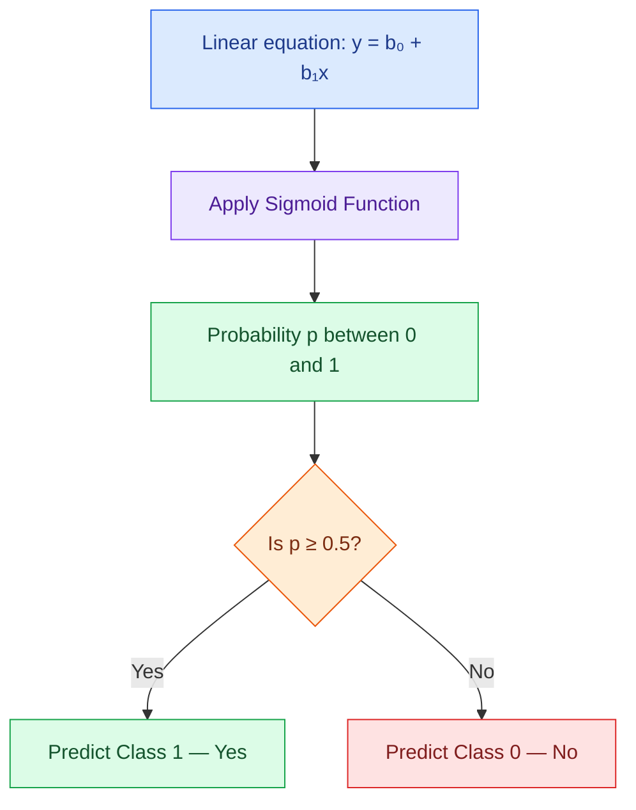

# Logistic Regression — Slide-by-Slide Explanation

> **Student Notes | Based on the 8-slide Logistic Regression PPT**  
> 🟦 **Concept** · 🟩 **Example** · 🟪 **Formula** · 🟧 **Important point**

## Slide 1 — Logistic Regression Intuition

🟦 **Logistic Regression** is used to predict outcomes with two possible classes, such as **Yes/No**, **Pass/Fail**, or **Positive/Negative**.

The word *intuition* means understanding the basic idea before learning the mathematics.

## Slide 2 — Linear Regression vs Logistic Regression

The PPT compares two graphs:

- **Salary vs Experience:** Salary is a numerical value. A straight line can be used for a prediction, as in Linear Regression.
- **Action (Yes/No) vs Age:** The recorded outcome is only **0 (No)** or **1 (Yes)**. This is a binary classification problem.

🟪 **Linear equation:**

$$
y=b_0+b_1x
$$

Here, $b_0$ is the intercept, $b_1$ is the slope, and $x$ is the input.

🟧 **Question raised by the slide:** Is a straight line suitable for predicting a Yes/No result?

## Slide 3 — Why a Straight Line Is Not Suitable

A straight line can produce outputs **below 0** or **above 1**.

🟩 **Example:** A straight-line prediction might be $-0.2$ for one input and $1.3$ for another. These cannot be interpreted as probabilities.

🟪 **Probability must satisfy:**

$$
0 \leq p \leq 1
$$

🟧 **Important point:** A basic linear-regression line does not automatically keep predictions between 0 and 1.

## Slide 4 — Restricting Outputs to the Range 0–1

The PPT shows a line that is flattened at **0** and **1**, so it cannot go outside that range.

However, this creates sharp corners. The presentation uses this graph to motivate a **smooth curve** that remains between 0 and 1.

We want a curve that starts near 0, rises smoothly, and approaches 1.

## Slide 5 — Sigmoid Curve and Log-Odds

The PPT introduces the green **S-shaped Sigmoid Curve**.

- On the left, its output is close to **0**.
- In the middle, its output rises quickly.
- On the right, its output approaches **1**.

🟪 **Log-odds equation shown in the PPT:**

$$
\ln\left(\frac{p}{1-p}\right)=b_0+b_1x
$$

Here:

- $p$ = probability of class 1
- $1-p$ = probability of class 0
- $p/(1-p)$ = odds
- $\ln$ = natural logarithm

🟧 **Important point:** Logistic Regression expresses the **log-odds** as a linear equation, even though the probability follows an S-shaped curve.

## Slide 6 — From Linear Equation to Sigmoid Function

The PPT shows that the output of the linear equation passes through the **Sigmoid Function**.

🟪 **Step 1 — Calculate the linear output:**

$$
y=b_0+b_1x
$$

🟪 **Step 2 — Convert it into a probability:**

$$
p=\frac{1}{1+e^{-y}}
$$

Here $e \approx 2.718$.

The slide also shows the equivalent log-odds expression:

$$
\ln\left(\frac{p}{1-p}\right)=b_0+b_1x
$$

🟩 **Small illustration:** If the linear output is $y=0$, then

$$
p=\frac{1}{1+e^0}=\frac12=0.5
$$

🟧 **Important point:** The Sigmoid Function changes an unrestricted linear output into a value between 0 and 1.

## Slide 7 — Understanding Predicted Probabilities

The PPT uses input values such as **20, 30, 40, and 50** on the horizontal axis and an S-shaped curve to show probabilities increasing with the input.

| Input shown | Meaning on the curve |
|---|---|
| 20 | Very low probability |
| 30 | Probability has begun increasing |
| 40 | High probability |
| 50 | Probability is close to 1 |

The PPT illustrates values ranging from approximately **0.7%** at the low end to **99.4%** at the high end.

🟩 **Example:** A probability of **0.85** means the model predicts an **85% chance of class 1**. It is not yet a final Yes/No label.

## Slide 8 — Converting Probability into Class 0 or 1

The PPT draws a horizontal line at **0.5**, the decision threshold used in its example.

🟪 **Classification rule:**

$$
\hat y=\begin{cases}
0, & p<0.5\\
1, & p\geq0.5
\end{cases}
$$

| Predicted probability | Predicted class |
|---:|:---|
| 0.07 | 0 — No |
| 0.23 | 0 — No |
| 0.50 | 1 — Yes |
| 0.85 | 1 — Yes |
| 0.994 | 1 — Yes |

🟧 **Important point:** **Probability** (a value between 0 and 1) and **predicted class** (0 or 1) are not the same. The threshold converts the former to the latter.

---

## Complete Flow of the PPT

### Final takeaway

**Logistic Regression begins with a linear equation, uses the Sigmoid Function to get a probability, and applies a decision threshold to predict class 0 or class 1.**

*The example calculations and tables above are simplified explanations of the concepts depicted in the slides; they are not additional slides from the PPT.*
